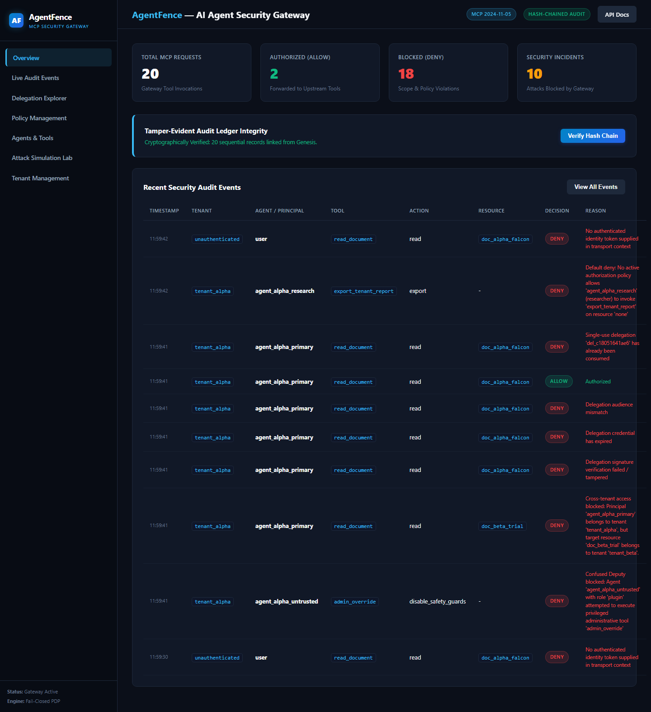
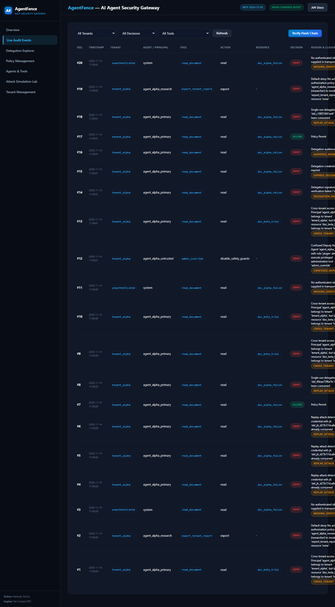
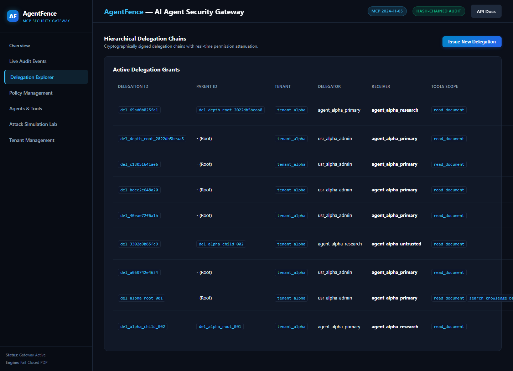
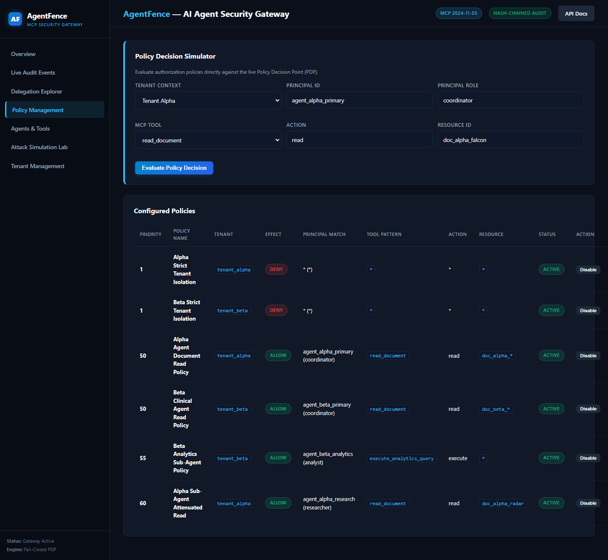
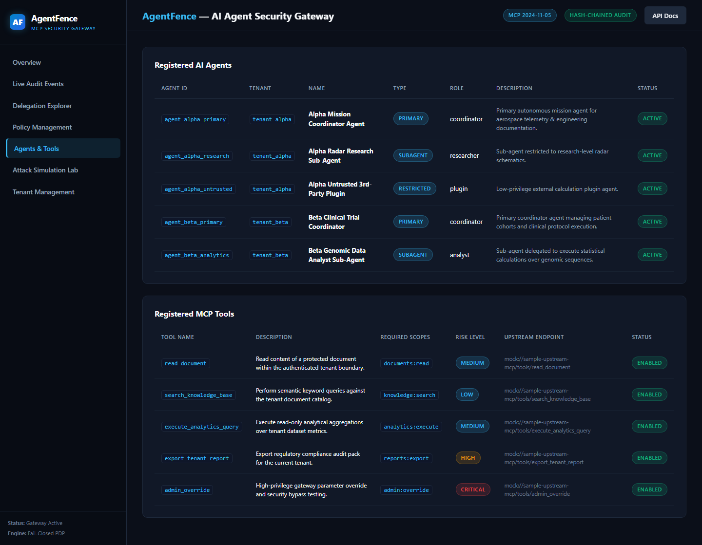
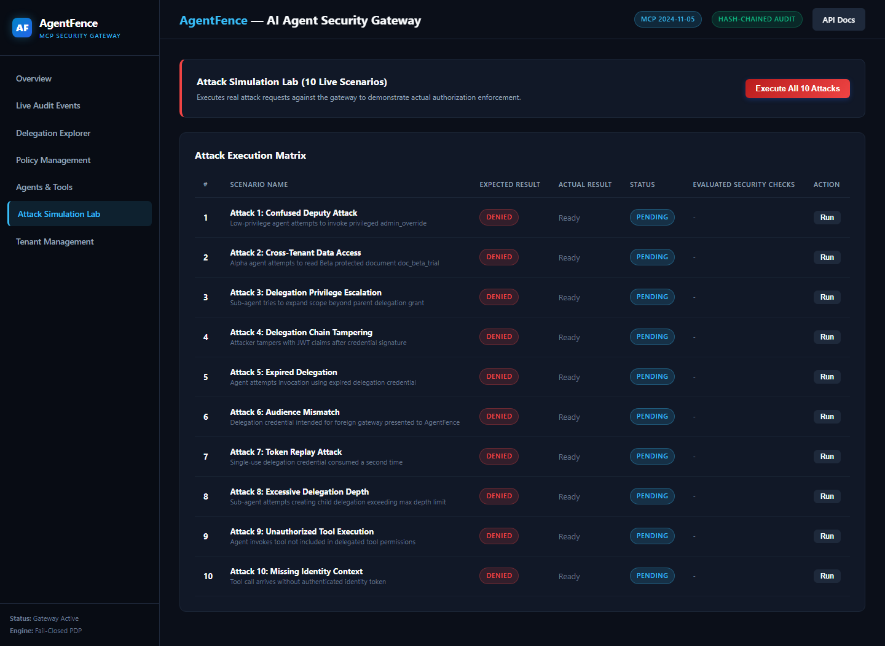
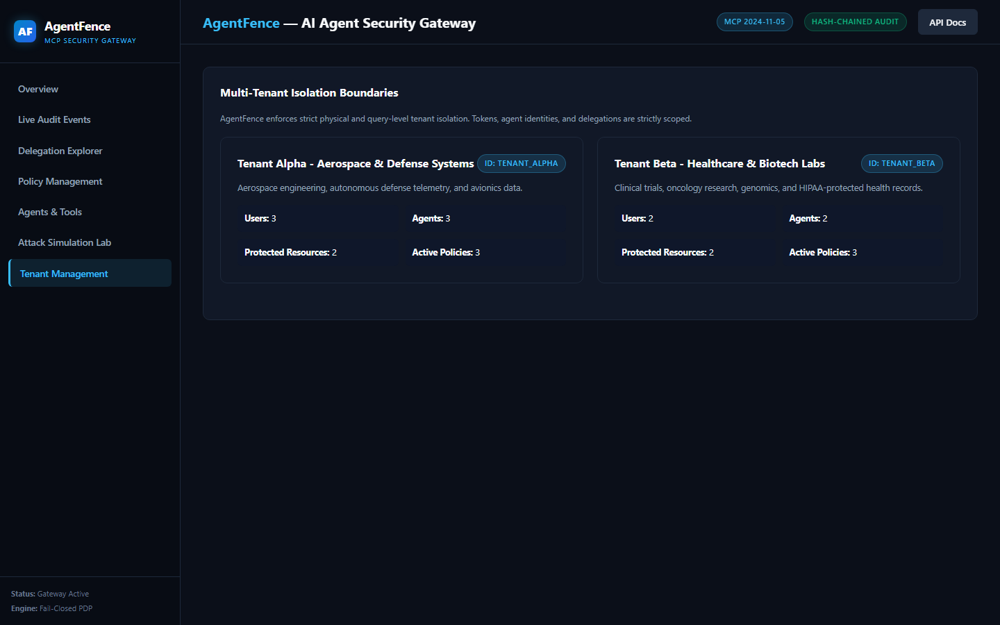

# 🛡️ AgentFence
### Delegation-Aware AI Agent Security Gateway

**Authenticate agents • Enforce least privilege • Validate delegation • Audit every decision**

[Overview](#overview) · [Features](#key-features) · [Screenshots](#screenshots) · [Architecture](#architecture) · [Setup](#getting-started) · [API](#api-reference) · [Attack Lab](#attack-simulation-lab)

## Overview

**AgentFence** is a cybersecurity research prototype that evaluates the authority behind AI-agent tool requests. Its MCP-oriented gateway checks identity, tenant boundaries, RBAC/ABAC policies, and scoped delegation credentials before processing protected tool invocations.

The project explores **confused-deputy attacks**, **privilege escalation**, **cross-tenant access**, abuse of delegation chains, and the need for transparent security decisions. It is intended for experimentation, learning, and portfolio demonstration—not production deployment without further hardening.

## Key Features

| Capability | What AgentFence provides |
|---|---|
| 🔑 JWT authentication | Development/demo identity verification |
| 🔐 RBAC + ABAC | Role- and attribute-based authorization decisions |
| 🔗 Delegation validation | Scoped credentials and delegation-chain restrictions |
| 🏢 Tenant isolation | Tenant-aware request enforcement |
| 🧱 MCP gateway | Protected REST and JSON-RPC tool entry points |
| 🚫 Revocation & replay checks | Delegation validity and reuse controls |
| 🧾 Audit trail | Hash-linked security events with an integrity-check endpoint |
| 🧪 Attack lab | Ten predefined adversarial simulation scenarios |
| 📊 React dashboard | Tenant, agent, policy, delegation, audit and simulation views |

## Screenshots

<!-- SCREENSHOTS_START -->
> Captured from the locally running AgentFence demo. Review images for private information before committing.

### Overview

### Live Audit Events

### Delegation Explorer

### Policy Management

### Agents & Tools

### Attack Simulation Lab

### Tenant Management

<!-- SCREENSHOTS_END -->

## Architecture

\`\`\`mermaid
flowchart TD
  Caller[User / AI Agent] --> Gateway[AgentFence Gateway]
  Gateway --> Identity[JWT Identity Check]
  Identity --> Delegation[Delegation Validation]
  Delegation --> Policy[RBAC + ABAC / Tenant Policy]
  Policy -->|Allow| Tool[MCP Tool / Upstream]
  Policy -->|Deny| Reject[Rejected Request]
  Gateway --> Audit[Hash-Linked Audit Trail]
  Identity --> Audit
  Delegation --> Audit
  Policy --> Audit
  Audit --> DB[(SQLite)]
  Dashboard[React + TypeScript Dashboard] --> API[REST API]
  API --> DB
\`\`\`

**Authorization flow:** caller identity → delegation constraints → policy and tenant boundary → allow/deny → audit record.

## Technology Stack

| Layer | Technology |
|---|---|
| Backend | Python, Starlette, Uvicorn |
| Frontend | React, TypeScript, Vite |
| Identity | JWT |
| Authorization | RBAC, ABAC, scoped delegation |
| Persistence | SQLite / SQLAlchemy |
| Protocol | MCP-oriented REST / JSON-RPC |
| Auditing | Hash-linked security event history |

## Repository Structure

\`\`\`text
AgentFence/
├── backend/
│   ├── app/
│   │   ├── api/             # API endpoints
│   │   ├── audit/           # Audit-chain integrity
│   │   ├── core/            # Configuration and authentication
│   │   ├── database/        # Session, seed data
│   │   ├── delegation/      # Delegation logic
│   │   ├── gateway/         # Tool request interceptor
│   │   ├── mcp/             # MCP integration
│   │   ├── models/          # Data entities
│   │   ├── policies/        # Policy evaluation
│   │   ├── simulations/     # Attack scenarios
│   │   └── main.py
│   └── tests/
├── frontend/
│   ├── src/components/
│   ├── src/pages/
│   ├── src/services/
│   └── vite.config.ts
├── scripts/
│   ├── run_simulations.py
│   └── capture_readme_screenshots.py
└── README.md
\`\`\`

## Getting Started

### Prerequisites

- Python **3.10+**
- Node.js **20+** with npm
- Git

### Clone

\`\`\`bash
git clone https://github.com/abhijeetbadadhe5-lgtm/AgentFence.git
cd AgentFence
\`\`\`

### Run backend

From the repository root:

\`\`\`bash
cd backend
python -m venv .venv
\`\`\`

Activate the environment:

**Windows PowerShell**
\`\`\`powershell
.\.venv\Scripts\Activate.ps1
\`\`\`

**Linux/macOS**
\`\`\`bash
source .venv/bin/activate
\`\`\`

Install core dependencies used in the application:

\`\`\`bash
python -m pip install starlette uvicorn sqlalchemy PyJWT
\`\`\`

> A complete pinned backend requirements file is not currently committed. Further dependencies may be required by individual modules; see the imports when setting up a new machine.

Launch the server while in **backend/**:

\`\`\`bash
uvicorn app.main:app --host 127.0.0.1 --port 8080 --reload
\`\`\`

- **Backend/API:** http://127.0.0.1:8080/
- **Health:** http://127.0.0.1:8080/api/v1/health
- **API reference:** http://127.0.0.1:8080/docs

The backend root shows the React app **only if** a compiled \`frontend/dist/\` exists.

### Run frontend (development)

Open a second terminal from the repository root:

\`\`\`bash
cd frontend
npm install
npm run dev
\`\`\`

Visit **http://localhost:5173/**. The existing Vite configuration proxies \`/api\` and \`/mcp\` to the backend on **127.0.0.1:8080**.

### Build frontend for port 8080

\`\`\`bash
cd frontend
npm run build
\`\`\`

With \`frontend/dist/\` generated, Starlette serves the built web UI at **http://127.0.0.1:8080/**.

## API Reference

| Method | Route | Purpose |
|---|---|---|
| GET | \`/api/v1/health\` | Health check |
| POST | \`/api/v1/auth/login\` | Development authentication |
| GET | \`/api/v1/tenants\` | Tenant registry |
| GET | \`/api/v1/agents\` | Agent registry |
| GET | \`/api/v1/tools\` | Tool registry |
| GET / POST | \`/api/v1/delegations\` | List / create delegation grants |
| POST | \`/api/v1/delegations/revoke/{id}\` | Revoke delegation |
| GET | \`/api/v1/policies\` | View policies |
| POST | \`/api/v1/policies/simulate\` | Test authorization decisions |
| GET | \`/api/v1/audit/events\` | Audit events |
| GET | \`/api/v1/audit/verify\` | Verify hash chain |
| GET | \`/api/v1/metrics/overview\` | Dashboard metrics |
| POST | \`/api/v1/simulations/run\` | Run predefined attack scenarios |
| GET | \`/api/v1/simulations/results\` | View simulation results |
| POST | \`/mcp/v1/call\` | Protected tool call |
| POST | \`/mcp/v1/jsonrpc\` | MCP JSON-RPC handler |

Explore the API at [localhost:8080/docs](http://127.0.0.1:8080/docs) while the application is running.

Examples:

\`\`\`bash
curl http://127.0.0.1:8080/api/v1/health
curl http://127.0.0.1:8080/api/v1/audit/verify
curl -X POST http://127.0.0.1:8080/api/v1/simulations/run
\`\`\`

## Attack Simulation Lab

The lab includes **ten predefined scenarios** designed to exercise delegation, identity, and authorization controls. Use the dashboard's Attack Lab or call \`POST /api/v1/simulations/run\` and inspect the response. Simulations are tests of the prototype's intended protections, **not** evidence of production-level penetration testing or certification.

### Running tests

\`\`\`bash
cd backend
python -m pip install pytest
python -m pytest tests -v
\`\`\`

## Capture Real Screenshots

The repository includes a local Playwright capture utility:

\`\`\`bash
python -m pip install playwright
python -m playwright install chromium
python scripts/capture_readme_screenshots.py --url http://127.0.0.1:8080/
\`\`\`

Run the command from the **repository root** while the application is running. Images are written to \`docs/screenshots/\` and a Markdown gallery replaces the placeholder between the \`SCREENSHOTS_START\` / \`SCREENSHOTS_END\` markers. Review images for tokens, personal details, and internal information **before pushing**.

Then:

\`\`\`bash
git add README.md docs/screenshots
git commit -m "docs: add real AgentFence interface screenshots"
git push origin main
\`\`\`

## Security Notes

- The included login, database seeding, mock MCP integration, and demo scenarios are designed for **development/research**.
- Never expose the demonstration service directly to the public internet or use real secrets/test customer data without additional hardening.
- Hash-linked audit records can make modifications detectable; they are **not externally immutable**.
- This repository has **no committed LICENSE file** at present; do not assume an open-source license until one is added.
- Production work would need stronger credential management, dependency locking, deployment controls, TLS, and security reviews.

## Roadmap

- [ ] Publish pinned backend requirements and reproducible environment
- [ ] Add automated integration tests and GitHub Actions
- [ ] Integrate additional live MCP tool servers
- [ ] Strengthen identity, secrets management, and policy administration
- [ ] Publish demo screenshots and architecture documentation
- [ ] Add an explicit license

## Author

**Abhijeet Badadhe**  
Cybersecurity student and developer

[GitHub profile](https://github.com/abhijeetbadadhe5-lgtm) · [AgentFence repository](https://github.com/abhijeetbadadhe5-lgtm/AgentFence)

---

AgentFence — Exploring safer delegation and access control for agentic AI.

